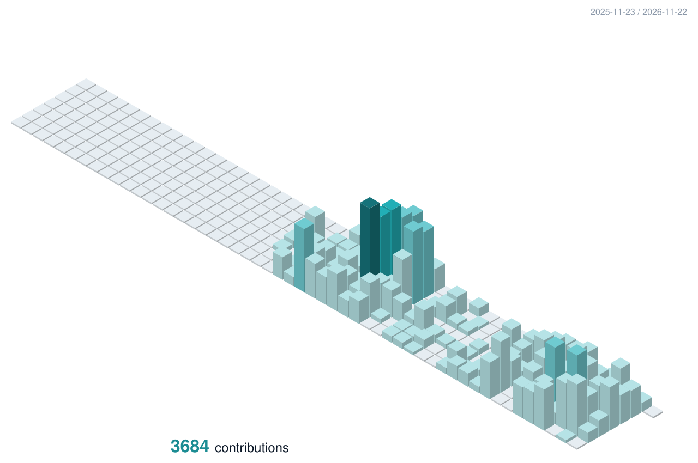

# Hey, I'm Ben

I build websites and software and keep them running, for businesses around Nuremberg at [Lang Software Development](https://lang-software.com).

## Currently building

- **FluxOS**: my own operating system, with Flux, a built-in AI assistant.
- **[lang-software.com](https://lang-software.com)**: my business website.

## What I build with

